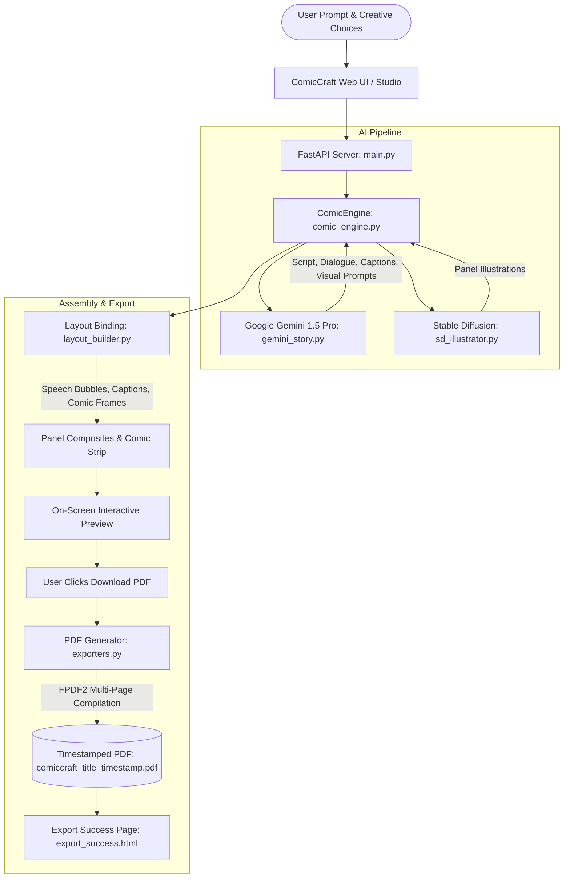

# 💥 ComicCraft — AI Comic Book & Graphic Novel Creator

ComicCraft is a web-based generative AI application built with **FastAPI**, **Google Gemini AI (Gemini 1.5 Pro)**, and **Stable Diffusion**. It streamlines the creative process of generating custom storylines, panel-by-panel dialogues, and comic-style illustrations automatically from user-provided prompts.

---

## 📖 Table of Contents
1. [Core Features](#-core-features)
2. [End-to-End System Architecture](#-end-to-end-system-architecture)
3. [Scenario Walkthroughs](#-scenario-walkthroughs)
   - [Scenario 1: Story Generation & Multimodal Visuals](#scenario-1-story-generation--multimodal-visuals)
   - [Scenario 2: Iterating on Tone & Art Style](#scenario-2-iterating-on-tone--art-style)
   - [Scenario 3: Layout Binding & Timestamped PDF Export](#scenario-3-layout-binding--timestamped-pdf-export)
4. [Hardware & Software Requirements](#-hardware--software-requirements)
5. [Installation & Setup](#-installation--setup)
6. [Project Structure](#-project-structure)
7. [API Reference](#-api-reference)
8. [Running Tests](#-running-tests)

---

## 🌟 Core Features

- **Gemini 1.5 Pro Story Engine**: Automatically structures plots into rising action, climax, and resolution with character speech bubbles, narrative captions, and sound effects (SFX).
- **Stable Diffusion Illustrator**: Supports local Hugging Face `diffusers` pipelines, cloud inference APIs, and built-in stylized artistic canvas engines.
- **`layout_builder.py` Engine**: Dynamically binds illustrations, titles, speech bubbles with comic pointer tails, sound effect badges, and panel frames into publication-ready composites.
- **`exporters.py` PDF Pipeline**: Compiles multi-page graphic novels with full cover art, consecutive panel story pages, and collector synopsis back covers using `fpdf2` with **timestamped filenames**.
- **Interactive Web Interface**: Live progress animations, interactive comic book reader, single-panel editing/re-rolling, and an **Export Success** confirmation page.

---

## 🏗️ End-to-End System Architecture



---

## 🎬 Scenario Walkthroughs

### Scenario 1: Story Generation & Multimodal Visuals
1. The user navigates to the ComicCraft Studio (`http://127.0.0.1:8000`).
2. The user enters a prompt describing their comic story:
   - **Prompt**: `"A brave fox exploring an enchanted forest."`
   - **Main Character**: `"Rusty the Fox"`
   - **Setting**: `"Enchanted Forest with glowing crystals"`
   - **Tone**: `"Dramatic"`
   - **Art Style**: `"Anime"`
3. The system combines **Gemini 1.5 Pro** for story generation and **Stable Diffusion** for image creation.
4. The user is redirected to the **Interactive Comic Preview** (`/preview/{comic_id}`), viewing cohesive panels with dialogue bubbles, narrative boxes, and anime illustrations.

### Scenario 2: Iterating on Tone & Art Style
1. After previewing, the user decides they want a lighter, cartoonish feel.
2. On the preview screen, the user clicks **"Iterate Mood & Style"** (or re-submits the form):
   - **Tone**: Changes from *"Dramatic"* to *"Funny"*.
   - **Art Style**: Changes from *"Anime"* to *"Classic Comic Book"*.
3. The system regenerates the entire pipeline:
   - Gemini receives tailored system instructions for comedy, producing humorous dialogue, witty narration, and slapstick sound effects (`SPLAT!`, `BOING!`).
   - Stable Diffusion receives classic comic book prompt enhancements (bold black ink, Jack Kirby style, halftone dot patterns, dynamic pulp cel-shading).
4. The user receives a completely updated comic matching their new creative vision.

### Scenario 3: Layout Binding & Timestamped PDF Export
1. After reviewing the on-screen preview, the user decides to download their comic and clicks **"Download Full PDF"**.
2. **Layout Binding**: `layout_builder.py` is invoked to assemble each panel's title, image, speech bubble, and narrative caption box into structured graphic composites.
3. **PDF Generation**: `exporters.py` compiles the comic into a multi-page PDF using **FPDF2**:
   - Page 1: Stylized Comic Book Cover with issue banner, protagonist info, and cover art.
   - Pages 2–N: Consecutive story pages placing panel images and narrative text boxes.
   - Final Page: Collector's edition back cover with complete synopsis and AI specifications.
   - The file is saved with a timestamped filename (e.g., `comiccraft_rusty_the_fox_20261003_091241.pdf`).
4. **Export Success**: The user is automatically redirected to `/export-success/{comic_id}`, which confirms the successful export, displays the timestamped filename and file size, provides a direct **"Download PDF"** button, and renders an embedded in-browser PDF reader.

---

## 💻 Hardware & Software Requirements

### Hardware Requirements
- **Processor**: Intel Core i5 (8th Gen or above) / AMD Ryzen 5 or equivalent
- **RAM**: Minimum 8 GB (Recommended: 16 GB for multitasking and local Diffusers/AWS Labs usage)
- **Storage**: 256 GB SSD (or 500 GB HDD minimum)
- **Internet Connectivity**: Stable high-speed internet (minimum 10 Mbps, recommended 20 Mbps)

### Software Requirements
- **Operating System**: Windows 10 / 11, macOS (Monterey or later), or Linux (Ubuntu 20.04+)
- **Web Browser**: Latest version of Google Chrome, Mozilla Firefox, or Microsoft Edge
- **Code Editor**: Visual Studio Code (recommended)
- **Python**: Version 3.8 or above
- **Version Control**: Git
- **Additional Tools**: AWS CLI (latest version)

---

## 🚀 Installation & Setup

### 1. Clone & Enter Project Directory
```bash
git clone <repository-url>
cd "nm project"
```

### 2. Create and Activate Virtual Environment
On Windows (PowerShell):
```powershell
python -m venv venv
.\venv\Scripts\Activate.ps1
```
On Linux / macOS:
```bash
python3 -m venv venv
source venv/bin/activate
```

### 3. Install Dependencies
```bash
pip install -r requirements.txt
```

### 4. Configure Environment Variables
Copy the example `.env` file:
```bash
copy .env.example .env   # Windows
# or: cp .env.example .env # Linux/macOS
```

Open `.env` and set your preferences:
```ini
# Google Gemini API Key (Get free key from https://aistudio.google.com/app/apikey)
GEMINI_API_KEY=your_gemini_api_key_here
GEMINI_MODEL=gemini-1.5-pro

# Stable Diffusion Provider: "cloud", "diffusers", "huggingface", or "mock"
SD_PROVIDER=cloud

# Hugging Face Token (optional for private models)
HF_TOKEN=
SD_MODEL_ID=stabilityai/stable-diffusion-2-1
```
*(Note: ComicCraft includes high-quality contextual story synthesis and cloud diffusion, so you can test immediately even before setting API keys!)*

### 5. Launch the Application
Using the runner script:
```bash
python run.py
```
Or double-click `start.bat` on Windows!

Open your browser and navigate to:
```
http://127.0.0.1:8000
```

---

## 📁 Project Structure

```
nm project/
│
├── .env.example               # Template environment configuration
├── README.md                  # Comprehensive project documentation
├── requirements.txt           # Python dependencies
├── run.py                     # Uvicorn launcher entrypoint
├── start.bat                  # 1-click Windows batch startup script
├── start.ps1                  # 1-click PowerShell startup script
├── layout_builder.py          # Root alias for layout binding engine
├── exporters.py               # Root alias for FPDF PDF compilation engine
│
├── app/
│   ├── __init__.py
│   ├── main.py                # FastAPI app, routing, templates, and REST APIs
│   ├── config.py              # App settings, paths, art style tokens
│   ├── layout_builder.py      # Core speech bubbles, captions, and panel assembly
│   ├── exporters.py           # Core FPDF2 comic book PDF compilation
│   │
│   ├── models/
│   │   ├── __init__.py
│   │   └── schemas.py         # Pydantic data models & request validation
│   │
│   ├── services/
│   │   ├── __init__.py
│   │   ├── gemini_story.py    # Google Gemini 1.5 Pro story generation
│   │   ├── sd_illustrator.py  # Stable Diffusion image synthesis
│   │   └── comic_engine.py    # Master pipeline orchestrator
│   │
│   ├── templates/
│   │   ├── base.html          # Base layout, navbar, loading modal, footer
│   │   ├── index.html         # Studio creative creator form & scenario presets
│   │   ├── preview.html       # Interactive comic reader with panel zoom/edit
│   │   ├── export_success.html# Scenario 3 confirmation & PDF download page
│   │   ├── gallery.html       # Saved issues library & reader
│   │   └── settings.html      # System diagnostics & hardware specs
│   │
│   └── static/
│       ├── css/
│       │   ├── style.css      # Design tokens, typography, responsive grid
│       │   └── comic_book.css # Comic panels, speech bubbles, SFX styling
│       ├── js/
│       │   ├── main.js        # Global UI helpers & PDF export caller
│       │   ├── studio.js      # Creative presets & live generation feedback
│       │   └── preview.js     # Iteration modal & panel re-roll scripts
│       └── images/
│           ├── logo.svg       # Brand vector icon
│           └── comic_banner.svg# Comic book cover art graphic
│
├── storage/
│   ├── comics/                # Generated comic issue metadata and panels
│   └── exports/               # Timestamped PDF export documents
│
└── tests/
    ├── __init__.py
    └── test_comiccraft.py     # Unit and scenario validation tests
```

---

## 📡 API Reference

| Method | Endpoint | Description |
|---|---|---|
| `GET` | `/` | Web Studio creative input interface |
| `POST` | `/api/generate` | Generates full comic strip (Gemini + Stable Diffusion) |
| `GET` | `/preview/{comic_id}` | Interactive comic reader and panel preview |
| `POST` | `/api/export-pdf` | Compiles PDF via `layout_builder.py` and `exporters.py` |
| `GET` | `/export-success/{comic_id}` | Export confirmation page with download button & reader |
| `POST` | `/api/regenerate-panel` | Edits dialogue, caption, or re-rolls single panel image |
| `GET` | `/gallery` | Comic library of all created issues |
| `GET` | `/settings` | System diagnostics & model configuration |
| `GET` | `/api/health` | Service health status check |

---

## 🧪 Running Tests

Execute the comprehensive test suite verifying Scenarios 1, 2, and 3:
```bash
pytest tests/test_comiccraft.py -v
```
All tests validate:
1. Gemini story breakdown and structured JSON parsing.
2. Stable Diffusion prompt engineering across art styles.
3. `layout_builder.py` composite binding with speech bubbles and captions.
4. `exporters.py` multi-page PDF generation with timestamped filenames.
5. Scenario 1, Scenario 2, and Scenario 3 workflow execution.

---

## 📜 License
Developed with ❤️ for comic creators, visual storytellers, and AI enthusiasts.
